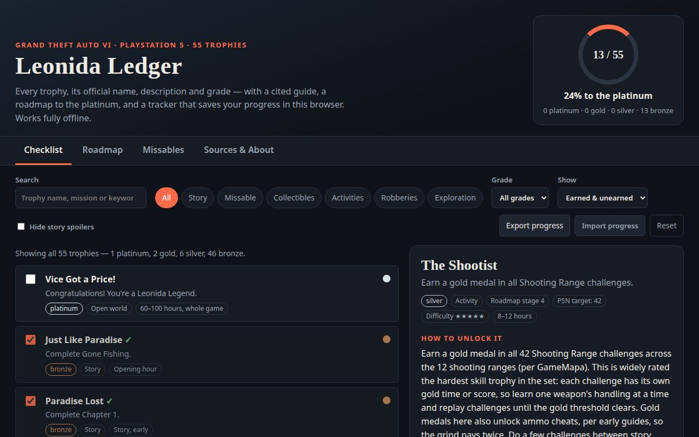
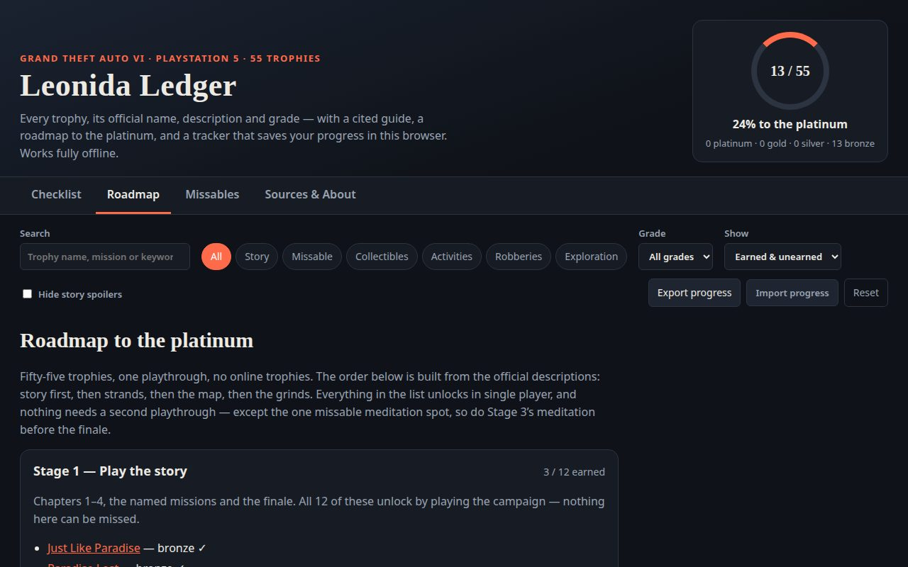
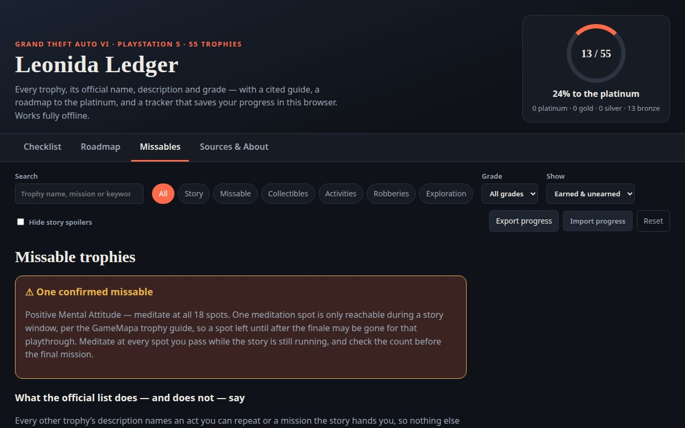
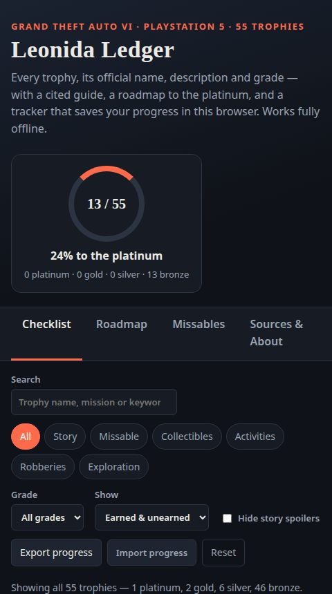

[](https://make.fun/bounty/gta6-trophy-guide-01)
[](https://make.fun/bounty/gta6-trophy-guide-01)
[](https://make.fun/bounty/gta6-trophy-guide-01)

# Leonida Ledger — GTA VI Trophy Guide & Tracker

An offline guide and tracker for all **55 Grand Theft Auto VI trophies** on PlayStation 5 (1 platinum, 2 gold, 6 silver, 46 bronze), built for the [make.fun GTA 6 trophy guide bounty](https://make.fun/bounty/gta6-trophy-guide-01). Static files, no build step, no network at run time — serve `app/` with any static server and open `index.html`.

## What it does

- **Checklist of the official list** — every trophy with its official name, description and grade as PlayStation publishes them, a checkbox to mark it earned, and progress saved in the browser (localStorage) with **export to a file and import back**.
- **A cited guide for every trophy** — what to do, where and how, and when it can be missed, written in this guide's own words. Each trophy's detail pane names its sources beside its guide (Exophase and PSNProfiles for the official list and PSN's tracked counts; KeenGamer and GameMapa where a count is cross-checked). Where the official description names no place or step, the guide says so instead of guessing.
- **Roadmap to the platinum** — six stages built from the official descriptions: story, stranger strands, exploring Leonida, activities and skill, robberies and money, then cleanup and 100% completion.
- **Missables flagged** — one confirmed missable (Positive Mental Attitude: one of the 18 meditation spots is only reachable during a story window), with the rest of the list explained as safe in a single playthrough.
- **Filters and search** — by kind (story, missable, collectibles, activities, robberies, exploration), by grade, by earned state, and by free text.
- **Spoiler setting** — hides the names and descriptions of un-earned story trophies until you earn them.
- **Progress at a glance** — the header shows your earned count by grade and your percentage toward the platinum.
- **Fully offline** — every file the app loads is a file under `app/`; it makes no network request. Source links in the detail pane open only when the reader follows them.

## Screenshots






## Run it

```sh
node serve.ts
# then open http://localhost:8080
```

## Hand it in

```sh
mkdir -p out && MAKEFUN_OUTPUT_DIR=out node main.ts
```

`main.ts` copies `app/` and `screenshots/` to the output directory and writes `dossier.json` with the vendored `vendor/makefun-frontend.ts` library.

## Sources

- Exophase — [Grand Theft Auto VI trophies](https://www.exophase.com/game/grand-theft-auto-vi-psn/trophies/): official names, descriptions and grades.
- PSNProfiles — [Grand Theft Auto VI trophies](https://psnprofiles.com/trophies/43531-grand-theft-auto-vi): grades and PSN's tracked progress counts.
- KeenGamer — [GTA 6 Trophy Guide & Platinum Roadmap](https://www.keengamer.com/articles/guides/gta-6-trophy-guide-platinum-roadmap-all-55-trophies/): roadmap order and 100% checklist contents.
- GameMapa — [All 55 GTA 6 Trophies](https://gamemapa.com/en/gta-6/guides/gta-6-trophy-achievement-list/): cross-checked list, counts and the missable meditation spot.

## License

MIT — see [LICENSE](LICENSE). Leonida Ledger is an independent, fan-made guide. It is not affiliated with Rockstar Games, Take-Two Interactive or Sony Interactive Entertainment, and it uses no Rockstar logo, artwork or game screenshots.
